# Brightlife SHG — Master Product Backlog & Task Ledger
*Maintained and governed by `@scrum` (Technical Scrum Master & Delivery Orchestrator).*  
*Single Source of Truth for all completed, in-progress, and pending engineering deliverables.*

---

## 1. Executive Sprint Overview

| Metric | Status |
| :--- | :--- |
| **Current Live Release** | **`v128`** (Google Apps Script Build `@129`, Commits `3236d9f` + `7eb083a`) |
| **Total Tracked Tasks** | **33 Tasks** (Expanded with `ARC-1`–`ARC-4`, `UI-4`–`UI-7`, `COM-3` & `SET-1`) |
| **Completed & Shipped (`[DONE]`)** | **24 Tasks (72.7%)** |
| **Active In-Flight (`[IN PROGRESS]`)** | **0 Tasks** (Ready for Sprint Commitment) |
| **Prioritized Backlog (`[BACKLOG]`)** | **9 Tasks (27.3%)** |
| **Current Sprint Focus** | `SET-1: Admin Loan Policy & Group Settings Management` (Dashboard-Native Loan Flow) |

---

## 2. Completed Deliverables (Shipped in Production)

| Task ID | Domain | Title & Description | Target Agents | Shipped Release | Date Completed |
| :---: | :---: | :--- | :---: | :---: | :---: |
| **`RPT-4`** | Financial | **Official AGM & Bank Audit Export Pack**: One-click generation of the combined institutional Brightlife SHG Annual Financial Pack (Executive PDF combining Balance Sheet `RPT-1`, Income Statement `RPT-2`, and Capital Projects summary with BLG letterhead, verification reference hash, watermark, and confidentiality audit stamps, plus multi-statement RFC-4180 CSV / Excel audit package export), adhering to `bg-slate-900` / `dark:bg-slate-100`, `min-h-[38px]`, and `tabular-nums` design tokens. | `@designer`, `@fixer`, `@sentinel` | **`v128`** (`@129`) | 2026-11-19 |
| **`COM-3`** | Communications | **Institutional Communications Polish, HTML Email Escaping, Statement Preview Parity & WhatsApp Alignment**: Enforced strict HTML escaping on dynamic fields in outgoing HTML emails, ensured Statement Preview modal parity with delivered statements, and aligned WhatsApp message formatting and dispatch templates with institutional standards. | `@messenger`, `@fixer`, `@designer`, `@sentinel` | **`v127`** (`@128`) | 2026-11-19 |
| **`UI-7`** | UI/UX | **Date Period / Range Selector & 1-Click Direct WhatsApp Launch**: Implemented Date Period / Range Selector for flexible statement filtering, enabled 1-Click Direct WhatsApp Launch for member statement delivery, fixed active period preset hover state, and aligned confirm modal buttons to dark/light theme. | `@designer`, `@fixer`, `@sentinel` | **`v124`–`v126`** (`@125`–`@127`) | 2026-11-19 |
| **`UI-6`** | UI/UX | **Statements & Confirm Modal Theme Polish, Period Selector & WhatsApp Action Fix**: Polished Light/Dark institutional theme parity across the Statements view and Confirm Modal, implemented custom Tailwind Period dropdown, dark/light button consistency, and resolved WhatsApp blank tab & action dispatch. | `@designer`, `@fixer`, `@sentinel` | **`v122`–`v123`** (`@123`–`@124`) | 2026-11-19 |
| **`UI-5`** | UI/UX & Backend | **Server CacheService, SheetContext & 20-Row Pagination for Dividends & Statements**: Combined server `CacheService`, request-scoped `SheetContext`, and background prefetch to optimize first-visit load times, and added 20-row default pagination to both the **Verified Fund Statements** table (`Dividends`) and **Members Statement Dispatch** table (`Statements`). | `@fixer`, `@designer`, `@sentinel` | **`v121`** (`@122`) | 2026-11-19 |
| **`UI-4`** | UI/UX | **Unified Client-Side SWR Cache & Zero-Skeleton Tab Navigation**: Implemented unified client-side Stale-While-Revalidate (SWR) caching across `dividends`, `statements`, `contributions`, `loans`, `investments`, `accounts`, and `roles`, serving cached view data immediately on tab switch with background revalidation, zero repeated skeletons, and mutation-based cache invalidation. | `@designer`, `@fixer`, `@sentinel` | **`v120`** (`@121`) | 2026-11-19 |
| **`ARC-4`** | Architecture | **Request-Scoped SheetContext & RPC Optimization Pipeline**: Implemented request-scoped `SheetContext` (`server/context.service.js`) batching and lazily caching open sheet instances and multi-range reads per HTTP execution across `apiGetDashboardData` and `apiGetReportsData`, cutting dashboard/report load roundtrips to <= 8 optimized reads with metadata-driven column header resolution. | `@fixer`, `@sentinel` | **`v119`** (`@120`) | 2026-11-19 |
| **`ARC-3`** | Architecture | **Google Sheets Formula Offloading & Materialized View (`Summary KPIs`)**: Deprecated per-row formula injections in `Contributions` and `Members`; installed Row 2 spill formulas (`MAP`, `LAMBDA`, `SUMIFS`, `XLOOKUP`) with plain Row 1 Native Table headers across `Members`, `Contributions`, `Loans`, `Loan Repayments`, `Guarantors`, `Investments`, and `Investment Projects`; provisioned 15-metric `Summary KPIs` materialized view tab, single-range O(1) read path (`readSummaryKpisSnapshot_`, `getSummaryKpisData`), migrated `InvestmentLedger`, retired `CIC Transactions`, and applied `#0F2A44` Native Tables with immediate-flush typed-column guards. | `@ledger`, `@analyst`, `@fixer` | **`v114`–`v118`** (`@115`–`@119`) | 2026-11-19 |
| **`ARC-2`** | Architecture | **Plug-and-Play 3-Tier Investment & Tangible Capital Venture Engine**: Implemented Tier 1 `Investments` market valuation columns (Units Held, Unit Cost, Current Price, FVTPL Carrying Value), Tier 2 `Investment Projects` register (Bee Keeping, Land, Agribusiness), Tier 3 unified `Investment Cashflows` ledger merged non-destructively with legacy `InvestmentLedger`, RPT-1/RPT-2 valuation & dividend rollups, and idempotent `?setupWorkbook=1` provisioner. | `@ledger`, `@analyst`, `@fixer` | **`v113`** (`@114`) | 2026-11-19 |
| **`ARC-1`** | Architecture | **Institutional Schema Standard & Reference Data Architecture**: Standardized all sheet tab names to Institutional Title Case with Single Spaces, implemented bidirectional backward-compatible alias resolution dictionary in `config.js` (`SHEETS.MEMBERS`, `SHEETS.INVESTMENTS`, etc.), restructured `Constants` sheet into formal reference tables (`Asset_Classes`, `Project_Categories`, `Payment_Channels`, `Statutory_Thresholds`) with dynamic data validation dropdown rules. | `@ledger`, `@migrator`, `@fixer` | **`v112`** (`@113`) | 2026-11-19 |
| **`RPT-2`** | Financial | **Statement of Comprehensive Income (Profit & Loss / P&L)**: Audited IFRS operating performance statement on `Reports` tab with 4-card revenue/surplus ribbon, operating revenue breakdown, investment yields, operating expenses, impairment deduction, net distributable surplus, zero-variance dividend basis, RFC-4180 CSV export, and BLG letterhead print preview. | `@analyst`, `@fixer`, `@designer` | **`v111`** (`@112`) | 2026-11-19 |
| **`RPT-1`** | Financial | **Statement of Financial Position (Balance Sheet)**: Audited IFRS/SASRA Balance Sheet on `Reports` tab with dual-column classical ledger, 4-card solvency ribbon, zero-variance guarantee, RFC-4180 CSV export, and BLG letterhead print preview. | `@analyst`, `@fixer`, `@designer` | **`v110`** (`@111`) | 2026-11-19 |
| **`FIN-1`** | Financial | **Decoupled PAR & 3-Tier Delinquency Waterfall**: Decoupled Portfolio at Risk from guarantor shortfall; implemented 3-tier delinquency classification (explicit status $\to$ due date $\to$ tenor) and Section 51 statutory provisioning. | `@analyst`, `@fixer` | **`v102`** (`@103`) | 2026-11-18 |
| **`FIN-2`** | Financial | **Net Liquid Cash Reconciliation**: Replaced artificial `savings - loans` formula with true verified physical bank accounts + CIC MMF liquidity summary and fallback waterfall. | `@analyst`, `@fixer` | **`v104`** (`@105`) | 2026-11-19 |
| **`FIN-3`** | Financial | **Multi-Source Cashflow Restoration**: Re-wired period inflows (repayments, yields, revenue) and outflows (disbursements, expenses) across active date ranges. | `@analyst`, `@fixer` | **`v105`** (`@106`) | 2026-11-19 |
| **`UI-HDR`** | UI/UX | **Borderless Header & Sub-Navigation Tabs**: Replaced bulky card with canvas header (removed redundant name/A/C/+Add Member) and introduced `[Overview] [Analytics] [Reports]` segmented tabs. | `@designer` | **`v106`** (`@107`) | 2026-11-19 |
| **`VIS-1`** | Visual | **Cash Flow Waterfall Chart**: Implemented IAS 7 liquid cash flow bridge ($\text{Opening} + \text{Inflows} - \text{Outflows} = \text{Closing}$) with floating bars and decomposition matrix on `Analytics` tab. | `@analyst`, `@designer`, `@fixer` | **`v107`** (`@108`) | 2026-11-19 |
| **`VIS-2`** | Visual | **Cumulative Savings vs. Loan Exposure Trajectory**: Implemented rolling 12-month area/line chart against the SASRA 85% prudential ceiling with 4-band leverage KPI strip on `Analytics` tab. | `@analyst`, `@designer`, `@fixer` | **`v108`** (`@109`) | 2026-11-19 |
| **`VIS-3`** | Visual | **SASRA Delinquency Aging Buckets & Provisioning Matrix**: Implemented full 5-tier statutory impairment schedule (1%, 5%, 25%, 50%, 100%), horizontal bar chart, and Net Carrying Loan Asset audit table on `Analytics` tab. | `@analyst`, `@designer`, `@fixer` | **`v109`** (`@110`) | 2026-11-19 |
| **`UI-1A`** | UI/UX | **Interactive Search, Filtering & Pagination**: Instant live search, multi-criteria filtering, and 10-per-page pagination across all 6 data tables. | `@designer` | **`v96`** (`@97`) | 2026-11-18 |
| **`UI-1B`** | UI/UX | **Responsive Mobile Layout & Touch Targets**: 38–44px touch targets, mobile card wrapping, and responsive table navigation. | `@designer` | **`v95`** (`@96`) | 2026-11-18 |
| **`UI-1C`** | UI/UX | **Institutional Theme Engine & Modal Purity**: Zero-flash theme boot, Sun/Moon switcher, and 100% pure Light Mode / Dark Mode across all 15 modals. | `@designer` | **`v97`–`v103`** | 2026-11-18 |
| **`MIG-1`** | Migration | **CIC MMF Historical Statement Ingestion**: Ingested 138 transactions and 66 monthly statements back to May 2021, fully reconciling closing balances to the exact cent. | `@migrator`, `@ledger` | **`v90`–`v92`** | 2026-11-18 |
| **`COM-1`** | Communications | **Automated WhatsApp & Email Transaction Receipts**: Implemented `triggerTransactionReceipt(txData)`, `buildReceiptHtmlEmail_`, and `buildReceiptWhatsAppMessage_` in `src/comms/notifications.service.js`, integrated into `addContribution`, `updateContributionStatus` (`src/server/contributions.service.js`) and `addLoanRepayment`, `updateLoanRepaymentStatus` (`src/server/loans.service.js`), with UI triggers (`shareContributionWhatsApp`, `shareLoanPaymentWhatsApp`) and `v127` (`COM-3`) polish. | `@messenger`, `@fixer` | **`v66`** (polished **`v127`**) | 2026-11-19 |

---

## 3. Prioritized Unworked Backlog (The Road Ahead)

The remaining 9 tasks are categorized below in strict execution priority:

### Tier 1: Next Sprint Focus — Dashboard-Native Loan & Policy Engine (`P0`)

#### 1. `SET-1: Admin Loan Policy & Group Settings Management`
* **Priority:** `P0 (Next Sprint Focus)`
* **Domain:** Configuration & Core Policy (`@ledger` $\to$ `@fixer` $\to$ `@designer` $\to$ `@sentinel`)
* **Location:** New `Settings` view (`Settings.html`) & `Constants` sheet tab
* **Objective:**
  - Provision dynamic policy key-value and tier tables in `Constants`:
    - `Borrower Savings Multiplier` (e.g., `2x`, `3x`)
    - `Loan Interest Rate Pct` (e.g., `10%`)
    - `Loan Tenor Tiers` based on amount (e.g., Up to 50k: 3 mos, 50k–100k: 6 mos, >100k: 12 mos)
    - `Minimum Guarantor Count`
  - Build dedicated Admin Settings Page in dashboard with institutional Light/Dark theme styling (`DESIGN.md`, `bg-slate-900` / `dark:bg-slate-100`, `min-h-[38px]`, `tabular-nums`).
  - Expose secure server RPCs (`getLoanPolicySettings`, `saveLoanPolicySettings`) with RBAC admin check and audit logging in `SHEETS.AUDIT_LOG`.
* **Dependencies:** `ARC-1` (Shipped in v112).
* **Acceptance Criteria:**
  - Policy key-value and tenor-tier tables provisioned idempotently in `Constants`.
  - Admin Settings UI renders cleanly in Light & Dark modes and persists changes via `saveLoanPolicySettings`.
  - Non-admin callers are rejected by RBAC check; all policy updates are logged in `SHEETS.AUDIT_LOG`.
  - Automated Node syntax/VM tests pass and `@sentinel` issues `SECURITY_CLEARANCE: PASS`.

---

### Tier 2: Governance, Core Loan Workflows & Data Reconciliation (`P1`)

#### 2. `UI-2: Native Dashboard Loan Application Workflow`
* **Priority:** `P1 (High)`
* **Domain:** User Experience & Core Operations (`@designer` $\to$ `@fixer` $\to$ `@sentinel`)
* **Location:** `Loans.html` (`Apply for Loan` modal)
* **Objective:** Transition to a 100% Dashboard-Native Loan Application flow:
  - Dynamic loan application modal reading active policy limits from `SET-1` (dynamic 2x/3x cap, dynamic interest rate, dynamic tenor tier options).
  - Live borrower savings lookup, real-time guarantor unencumbered savings check, and live deficit/shortfall tracker.
  - Interactive amortization & installment schedule calculator (`tabular-nums`).
  - Atomic insert to `Loans` with `Status = "Pending Review"`.
* **Dependencies:** `SET-1` (Data schema in `SHEETS.LOANS` and `SHEETS.GUARANTORS` is ready).
* **Acceptance Criteria:**
  - Modal dynamically enforces `SET-1` multiplier, interest rate, tenor tiers, and minimum guarantor count.
  - Guarantor unencumbered savings & shortfall tracker updates live; atomic write sets `Status = "Pending Review"`.
  - Automated Node syntax/VM tests pass and `@sentinel` issues `SECURITY_CLEARANCE: PASS`.

#### 3. `GOV-1: Multi-Signature Dual-Officer Loan Approval Workflow`
* **Priority:** `P1 (High)`
* **Domain:** Governance & Internal Controls (`@ledger` $\to$ `@fixer` $\to$ `@designer` $\to$ `@sentinel`)
* **Location:** `Loans.html` & `server/loans.service.js`
* **Objective:** Prevent single-user loan disbursement fraud via a dual-officer approval pipeline:
  - Chairperson initial review $\to$ Treasurer disbursement authorization before loan moves to `Approved` and triggers disbursement.
  - Guarantor liability locking in `Guarantors` sub-ledger.
  - Automated WhatsApp + Email notification dispatch and audit trail logging in `SHEETS.AUDIT_LOG`.
* **Dependencies:** `UI-2`.
* **Acceptance Criteria:**
  - Single officer cannot self-approve both stages; Chairperson review and Treasurer authorization are enforced server-side.
  - Guarantor liabilities lock atomically in `Guarantors` sub-ledger upon approval; WhatsApp/Email notifications and `SHEETS.AUDIT_LOG` entries are recorded.
  - Automated Node syntax/VM tests pass and `@sentinel` issues `SECURITY_CLEARANCE: PASS`.

#### 4. `MIG-2: Equity Bank Statement Ingestion & Historical Account Reconciliation`
* **Priority:** `P1 (High)`
* **Domain:** Migration & Audit (`@migrator` $\to$ `@ledger`)
* **Location:** `SHEETS.ACCOUNTS` & `SHEETS.FUND_STATEMENTS`
* **Objective:** Ingest historical Equity Bank statements into itemized transaction records, reconciling physical bank credits against recorded member contribution dates.
* **Dependencies:** `ARC-1` (Shipped in v112).

---

### Tier 3: Advanced Intelligence, Migration & Platform Hardening (`P2`)

#### 5. `MIG-3: One-Time 'Form Loan Requests' Backfill & Google Form Deprecation`
* **Priority:** `P2 (Medium)`
* **Domain:** Migration & Audit (`@migrator` $\to$ `@ledger`)
* **Location:** `src/migration/loan.form.migration.js` & `SHEETS.LOANS`
* **Objective:** One-time historical ingestion of legacy form responses from `Form Loan Requests` into `SHEETS.LOANS`, logging all migrated records to `SHEETS.AUDIT_LOG`, and permanently retiring the external Google Form.
* **Dependencies:** `UI-2`, `GOV-1`.
* **Acceptance Criteria:**
  - Idempotent backfill script ingests all unmigrated `Form Loan Requests` rows into `SHEETS.LOANS` without duplicates.
  - Full migration summary recorded in `SHEETS.AUDIT_LOG` and external Google Form retired.

#### 6. `RPT-3: Statement of Changes in Equity & Direct Cash Flow Statement`
* **Priority:** `P2 (Medium)`
* **Domain:** Financial Reporting (`@analyst` $\to$ `@fixer` $\to$ `@designer`)
* **Location:** `Reports` tab
* **Objective:** Full multi-year capital progression tracking and IAS 7 direct cash flows (Operating, Investing, Financing).
* **Dependencies:** RPT-1, RPT-2.

#### 7. `UI-3: Advanced Ledger Multi-Sort & Filter Presets`
* **Priority:** `P2 (Medium)`
* **Domain:** UI/UX (`@designer`)
* **Location:** `Contributions.html`, `Loans.html`, `Members.html`
* **Objective:** Column header click-to-sort (Asc/Desc), saved filter presets (e.g. "Overdue Only", "Unallocated"), and multi-column export.
* **Dependencies:** UI-1A.

#### 8. `COM-2: End-of-Month Automated Member Statements & Dividend Projections`
* **Priority:** `P2 (Medium)`
* **Domain:** Member Communications (`@messenger` $\to$ `@fixer`)
* **Location:** `server/comms.service.js`
* **Objective:** Scheduled monthly batch delivery of individual member financial summaries, showing personal savings balance, active loan installments due, and projected year-end dividend yield.
* **Dependencies:** COM-1, RPT-2.

#### 9. `SEC-1: Tamper-Evident Ledger Hashing & Audit Log Retention`
* **Priority:** `P2 (Medium)`
* **Domain:** Security & Compliance (`@sentinel` $\to$ `@fixer`)
* **Location:** `server/audit.service.js`
* **Objective:** Cryptographic SHA-256 rolling hash chain on financial ledger entries to detect manual row tampering outside the Web App.
* **Dependencies:** None.

---

## 4. Scrum Sprint Dependency Map

```mermaid
graph TD
    subgraph Shipped_Deliverables ["Shipped in Production (v102 - v112)"]
        F1["FIN-1: Decoupled PAR"]
        F2["FIN-2: Net Liquid Cash"]
        F3["FIN-3: Cashflow Period Feeds"]
        H["UI-HDR: Borderless Header & Sub-Nav"]
        V1["VIS-1: Cash Flow Waterfall"]
        V2["VIS-2: Savings vs. Loan Trajectory"]
        V3["VIS-3: SASRA Aging & Provision Matrix"]
        R1["RPT-1: Statement of Financial Position"]
        R2["RPT-2: Statement of Comprehensive Income"]
        A1["ARC-1: Schema Standard & Reference Constants"]
    end

    subgraph Architectural_Modernization ["Architectural Modernization Sprint (Active Focus)"]
        A2["ARC-2: 3-Tier Investment & Projects Engine<br>(Financial Assets + Tangible Ventures - P0)"]
        A3["ARC-3: Formula Offload & Summary KPIs<br>(Spill Formulas & Materialized View - P0)"]
        A4["ARC-4: Request-Scoped SheetContext<br>(<=8 RPC Reads & Column Mapping - P0)"]
    end

    subgraph Reporting_Capstone ["Reporting Suite Capstone (P0)"]
        R4["RPT-4: Official AGM & Bank Audit Pack<br>(PDF Letterhead & CSV Export)"]
    end

    subgraph Sprint_Follow_Up ["Follow-up Sprint (P1 Priorities)"]
        G1["GOV-1: Multi-Signature Dual-Officer Loan Approval"]
        M2["MIG-2: Equity Bank Statement Ingestion"]
        C1["COM-1: Automated WhatsApp/Email Receipts"]
    end

    subgraph Future_Enhancements ["Deferred & Backlog Enhancements (P2 Priorities)"]
        U2["UI-2: Member Loan Application Workflow<br>(Deferred by User)"]
        R3["RPT-3: Statement of Changes in Equity"]
        U3["UI-3: Column Sorting & Filter Presets"]
        C2["COM-2: Monthly Member Statements Dispatch"]
        M3["MIG-3: Legacy Workbook Ingestion"]
        S1["SEC-1: Tamper-Evident Ledger Hashing"]
    end

    A1 --> A2
    A1 --> A3
    A1 & A3 --> A4
    R1 & R2 & A1 & A2 --> R4
    U2 -.-> G1
    A1 --> M2
    R2 --> C2
    C1 --> C2
```

---

## 5. Scrum Master Operating Rules
1. **Single Source of Truth:** Any new feature request or bug must be assigned a unique Task ID and recorded in `BACKLOG.md` before implementation begins.
2. **Definition of Done (DoD):** A task is only marked `[DONE]` when:
   - Specialist agent has implemented code.
   - Automated Node syntax and VM tests pass (`15/15 PASS`).
   - `@sentinel` issues `SECURITY_CLEARANCE: PASS`.
   - `@shipper` commits code and deploys to Google Apps Script.
   - Release is recorded in `RELEASES.md` and `SYSTEM_CONTRACT.md`.
3. **Transparency:** Whenever the user asks "what are we working on?" or "what remains?", `@scrum` provides the exact burndown from this ledger.
