# Brightlife SHG — Master Product Backlog & Task Ledger
*Maintained and governed by `@scrum` (Technical Scrum Master & Delivery Orchestrator).*  
*Single Source of Truth for all completed, in-progress, and pending engineering deliverables.*

---

## 1. Executive Sprint Overview

| Metric | Status |
| :--- | :--- |
| **Current Live Release** | **`v111`** (Google Apps Script Build `@112`, Commit `004929a`) |
| **Total Tracked Tasks** | **27 Tasks** (Expanded with Architectural Modernization `ARC-1`–`ARC-4`) |
| **Completed & Shipped (`[DONE]`)** | **13 Tasks (48.1%)** |
| **Active In-Flight (`[IN PROGRESS]`)** | **0 Tasks** (Ready for Sprint Commitment) |
| **Prioritized Backlog (`[BACKLOG]`)** | **14 Tasks (51.9%)** |
| **Current Sprint Focus** | Phase 2.5: Architectural Modernization & AGM Audit Pack (`ARC-1` $\to$ `ARC-4`, `RPT-4`) |

---

## 2. Completed Deliverables (Shipped in Production)

| Task ID | Domain | Title & Description | Target Agents | Shipped Release | Date Completed |
| :---: | :---: | :--- | :---: | :---: | :---: |
| **`RPT-2`** | Financial | **Statement of Comprehensive Income (Profit & Loss / P&L)**: Audited IFRS operating performance statement on `Reports` tab with 4-card revenue/surplus ribbon, operating revenue breakdown, investment yields, operating expenses, impairment deduction, net distributable surplus, zero-variance dividend basis, RFC-4180 CSV export, and BLG letterhead print preview. | `@analyst`, `@fixer`, `@designer` | **`v111`** (`@112`) | 2026-11-19 |
| **`RPT-1`** | Financial | **Statement of Financial Position (Balance Sheet)**: Audited IFRS/SASRA Balance Sheet on `Reports` tab with dual-column classical ledger, 4-card solvency ribbon, zero-variance guarantee, RFC-4180 CSV export, and BLG letterhead print preview. | `@analyst`, `@fixer`, `@designer` | **`v110`** (`@111`) | 2026-11-19 |
| **`FIN-1`** | Financial | **Decoupled PAR & 3-Tier Delinquency Waterfall**: Decoupled Portfolio at Risk from guarantor shortfall; implemented 3-tier delinquency classification (explicit status $\to$ due date $\to$ tenor) and Section 51 statutory provisioning. | `@analyst`, `@fixer` | **`v102`** (`@103`) | 2026-11-18 |
| **`FIN-2`** | Financial | **Net Liquid Cash Reconciliation**: Replaced artificial `savings - loans` formula with true verified physical bank accounts + CIC MMF liquidity summary and fallback waterfall. | `@analyst`, `@fixer` | **`v104`** (`@105`) | 2026-11-19 |
| **`FIN-3`** | Financial | **Multi-Source Cashflow Restoration**: Re-wired period inflows (repayments, yields, revenue) and outflows (disbursements, expenses) across active date ranges. | `@analyst`, `@fixer` | **`v105`** (`@106`) | 2026-11-19 |
| **`UI-HDR`** | UI/UX | **Borderless Header & Sub-Navigation Tabs**: Replaced bulky card with canvas header (removed redundant name/A/C/+Add Member) and introduced `[Overview] [Analytics] [Reports]` segmented tabs. | `@designer` | **`v106`** (`@107`) | 2026-11-19 |
| **`VIS-1`** | Visual | **Cash Flow Waterfall Chart**: Implemented IAS 7 liquid cash flow bridge ($\text{Opening} + \text{Inflows} - \text{Outflows} = \text{Closing}$) with floating bars and decomposition matrix on `Analytics` tab. | `@analyst`, `@designer`, `@fixer` | **`v107`** (`@108`) | 2026-11-19 |
| **`VIS-2`** | Visual | **Cumulative Savings vs. Loan Exposure Trajectory**: Implemented rolling 12-month area/line chart against the SASRA 85% prudential ceiling with 4-band leverage KPI strip on `Analytics` tab. | `@analyst`, `@designer`, `@fixer` | **`v108`** (`@109`) | 2026-11-19 |
| **`VIS-3`** | Visual | **SASRA Delinquency Aging Buckets & Provisioning Matrix**: Implemented full 5-tier statutory impairment schedule (1%, 5%, 25%, 50%, 100%), horizontal bar chart, and Net Carrying Loan Asset audit table on `Analytics` tab. | `@analyst`, `@designer`, `@fixer` | **`v109`** (`@110`) | 2026-11-19 |
| **`UI-1A`** | UI/UX | **Interactive Search, Filtering & Pagination**: Instant live search, multi-criteria filtering, and 10-per-page pagination across all 6 data tables. | `@designer` | **`v96`** (`@97`) | 2026-11-18 |
| **`UI-1B`** | UI/UX | **Responsive Mobile Layout & Touch Targets**: 38–44px touch targets, mobile card wrapping, and responsive table navigation. | `@designer` | **`v95`** (`@96`) | 2026-11-18 |
| **`UI-1C`** | UI/UX | **Institutional Theme Engine & Modal Purity**: Zero-flash theme boot, Sun/Moon switcher, and 100% pure Light Mode / Dark Mode across all 15 modals. | `@designer` | **`v97`–`v103`** | 2026-11-18 |
| **`MIG-1`** | Migration | **CIC MMF Historical Statement Ingestion**: Ingested 138 transactions and 66 monthly statements back to May 2021, fully reconciling closing balances to the exact cent. | `@migrator`, `@ledger` | **`v90`–`v92`** | 2026-11-18 |

---

## 3. Prioritized Unworked Backlog (The Road Ahead)

The remaining 14 tasks are categorized below in strict execution priority:

### Tier 1: Architectural Modernization & Active Sprint Priorities

#### 1. `ARC-1: Institutional Schema Standard & Reference Data Architecture`
* **Priority:** `P0 (Top Architectural Foundation)`
* **Domain:** Core Data Architecture & Infrastructure (`@ledger` $\to$ `@migrator` $\to$ `@fixer`)
* **Location:** `Code.js`, `server/config.service.js`, `SHEETS.CONSTANTS`
* **Objective:** Standardize and institutionalize Google Sheets database schema and reference data:
  - Normalize all sheet tab names to Institutional Title Case with Single Spaces (`Members`, `Contributions`, `Loans`, `Guarantors`, `Accounts`, `Investments`, `Investment Projects`, `Investment Cashflows`, `Summary KPIs`, `Constants`, `Audit Log`).
  - Deploy backward-compatible alias resolution dictionary in `config.js` so legacy constant names (`MEMBERS`, `INVESTMENT_PROJECTS`, etc.) resolve seamlessly without breaking running sessions.
  - Consolidate reference data on `Constants` sheet into structured named tables: `Asset_Classes`, `Project_Categories`, `Payment_Channels`, and `Statutory_Thresholds`.
  - Configure cell data validation dropdown rules in transactional sheets reading from these reference tables.
* **Dependencies:** None (Baseline architectural foundation).
* **Definition of Done (DoD):**
  - Migration script executed or validated against live spreadsheet.
  - `config.js` updated with bidirectional legacy/modern sheet name mappings.
  - `Constants` sheet restructured with clear table headers and validation rules.
  - Automated Node syntax and VM tests pass (`15/15 PASS`).
  - `@sentinel` clearance PASS; zero runtime regressions in existing CRUD endpoints.

#### 2. `ARC-2: Plug-and-Play 3-Tier Investment & Tangible Capital Venture Engine`
* **Priority:** `P0 (Strategic Product Engine)`
* **Domain:** Investment Accounting & Core Operations (`@ledger` $\to$ `@analyst` $\to$ `@fixer`)
* **Location:** `server/investments.service.js`, `server/projects.service.js`, `Investments`, `Investment Projects`, `Investment Cashflows`
* **Objective:** Build the institutional plug-and-play investment engine supporting both financial assets and tangible capital ventures:
  - **Tier 1 (Financial Assets):** `Investments` sheet tracking liquid market instruments (MMFs, Equities/Shares, T-Bills, Fixed Deposits) with Cost Basis, Units Held, Current Nav/Price, Market Valuation, and Unrealized Gain/Loss.
  - **Tier 2 (Tangible Capital Ventures):** `Investment Projects` sheet tracking physical group ventures (Bee Keeping, Land Acquisition, Agribusiness, Commercial Real Estate) with Project Category, Approved Budget, Total Capital Deployed, Projected Revenue, Milestone Status, and Completion Date.
  - **Tier 3 (Unified Cashflows):** `Investment Cashflows` sheet tracking all money movements (Capital Outflows/Investments, Dividend/Yield Inflows, Capital Returns, Operational Project Expenses) linked by Asset ID or Project ID.
  - Integrate valuation rollups into `RPT-1` Balance Sheet (Total Investments Asset) and `RPT-2` Income Statement (Net Investment Yields & Project Surpluses).
* **Dependencies:** `ARC-1` (Normalized schema & reference tables).
* **Definition of Done (DoD):**
  - CRUD operations implemented and tested for both Financial Instruments and Capital Projects.
  - Transaction ledger writes and reconciles cash movements against physical accounts.
  - Service functions expose normalized APIs (`getInvestmentsSummary()`, `getProjectsSummary()`, `recordInvestmentCashflow()`).
  - Node syntax and VM mock tests pass (`PASS`); `@sentinel` clearance PASS.

#### 3. `ARC-3: Google Sheets Formula Offloading & Materialized View (Summary KPIs)`
* **Priority:** `P0 (Performance & Scalability)`
* **Domain:** Database Performance & Sheet Architecture (`@ledger` $\to$ `@analyst` $\to$ `@fixer`)
* **Location:** `Contributions`, `Loans`, `Summary KPIs`
* **Objective:** Offload heavy row-by-row server calculations to native Google Sheets array formulas and a single-row materialized view:
  - Deprecate row-by-row formula injection in `Contributions` (which severely bloated write latency and file calculation time).
  - Inject resilient header spill formulas (`MAP`, `LAMBDA`, `SUMIFS`, `FILTER`) in Row 1 for cumulative member savings balances and loan amortization balances.
  - Implement a dedicated single-row `Summary KPIs` sheet acting as a real-time materialized view (Total Member Savings, Total Disbursed, Total Outstanding Loans, Net Cash Position, Total Investment Assets, Active PAR %).
  - Update GAS read paths to query `Summary KPIs` in 1 instant range call instead of iterating hundreds of rows across 6 separate sheets.
* **Dependencies:** `ARC-1`.
* **Definition of Done (DoD):**
  - Row-by-row formula generation removed from backend contribution creation handlers.
  - Dynamic spill array formulas established in header rows of transactional sheets.
  - `Summary KPIs` tab generated and dynamically calculating from underlying sheets.
  - GAS KPI fetching latency reduced by >= 50%; Node syntax/VM tests pass; `@sentinel` clearance PASS.

#### 4. `ARC-4: Request-Scoped SheetContext & RPC Optimization Pipeline`
* **Priority:** `P0 (Engine Infrastructure)`
* **Domain:** Backend Optimization & Middleware (`@fixer` $\to$ `@sentinel`)
* **Location:** `server/context.service.js`, `server/core.service.js`
* **Objective:** Streamline Google Apps Script RPC execution and eliminate redundant spreadsheet roundtrips:
  - Introduce request-scoped `SheetContext` pattern that batches and lazily caches open sheet instances and multi-range reads per HTTP execution.
  - Cut dashboard/report load roundtrips from 15+ individual `SpreadsheetApp` calls down to <= 8 optimized reads.
  - Implement metadata-driven column header resolution to safeguard against manual column reordering by users.
* **Dependencies:** `ARC-1`, `ARC-3`.
* **Definition of Done (DoD):**
  - `SheetContext` class implemented and adopted across all core API endpoints (`apiGetDashboardData`, `apiGetReportsData`).
  - RPC execution profiling logs confirm <= 8 sheet reads per full dashboard payload load.
  - Header resolution unit tests pass; Node syntax and VM tests pass (`15/15 PASS`); `@sentinel` clearance PASS.

#### 5. `RPT-4: Official AGM & Bank Audit Export Pack`
* **Priority:** `P0 (Top Reporting Priority)`
* **Domain:** Document Governance (`@designer` $\to$ `@fixer` $\to$ `@sentinel`)
* **Location:** `Reports` tab (`#home-subview-reports`)
* **Objective:** One-click generation of the combined institutional Brightlife SHG Annual Financial Pack:
  - Executive PDF report combining Balance Sheet (`RPT-1`), Income Statement (`RPT-2`), and Capital Projects summary, styled with formal BLG letterhead, verification reference hash, watermark, and confidentiality audit stamps.
  - Full multi-statement CSV / Excel audit package export for commercial bank financing or SACCO regulator filing.
* **Dependencies:** `RPT-1` (Shipped in v110), `RPT-2` (Shipped in v111), `ARC-1` / `ARC-2`.
* **Definition of Done (DoD):**
  - One-click print preview generates comprehensive institutional AGM pack.
  - RFC-4180 CSV / Excel export generates verified multi-tab financial workbook.
  - Automated Node syntax and VM tests pass; `@sentinel` clearance PASS.

---

### Tier 2: Governance, Exports & Data Reconciliation

#### 6. `GOV-1: Multi-Signature Dual-Officer Loan Approval Workflow`
* **Priority:** `P1 (High)`
* **Domain:** Governance & Internal Controls (`@ledger` $\to$ `@fixer` $\to$ `@designer` $\to$ `@sentinel`)
* **Location:** `Loans.html` & `server/loans.service.js`
* **Objective:** Prevent single-user loan disbursement fraud by requiring dual authorization:
  - Chairperson initial review $\to$ Treasurer final authorization before loan moves to `Approved` and triggers disbursement.
  - Audit trail logging in `SHEETS.AUDIT_LOG`.
* **Dependencies:** UI-2.

#### 7. `MIG-2: Equity Bank Statement Ingestion & Historical Account Reconciliation`
* **Priority:** `P1 (High)`
* **Domain:** Migration & Audit (`@migrator` $\to$ `@ledger`)
* **Location:** `SHEETS.ACCOUNTS` & `SHEETS.FUND_STATEMENTS`
* **Objective:** Ingest historical Equity Bank statements into itemized transaction records, reconciling physical bank credits against recorded member contribution dates.
* **Dependencies:** `ARC-1`.

#### 8. `COM-1: Automated WhatsApp & Email Transaction Receipts`
* **Priority:** `P1 (High)`
* **Domain:** Member Communications (`@messenger` $\to$ `@fixer`)
* **Location:** `server/comms.service.js`
* **Objective:** Automatically dispatch instant branded SMS/WhatsApp receipts and email notifications to members whenever their contributions or loan repayments are approved.
* **Dependencies:** None (`@messenger` infrastructure).

---

### Tier 3: Advanced Intelligence, Workflows & Platform Hardening

#### 9. `UI-2: Working Member Loan Application Workflow` `[BACKLOGGED / DEFERRED]`
* **Priority:** `P2 (Deferred by User Request)`
* **Domain:** User Experience & Core Operations (`@designer` $\to$ `@fixer`)
* **Location:** `Loans.html` (`Apply for Loan` Modal)
* **Objective:** Replace static/placeholder loan request flow with an interactive, end-to-end loan application modal:
  - Dynamic Borrower Selection with real-time savings lookup.
  - Real-time 3x Borrowing Limit & Eligibility Calculation.
  - Real-time Guarantor Allocation & Guarantee Deficit Tracker.
  - Interactive Loan Calculator: Amortization schedule, monthly installments, total interest.
  - Server-side validation and write to `SHEETS.LOANS` with `Status = "Pending"`.
* **Dependencies:** None (Data schema in `SHEETS.LOANS` and `SHEETS.GUARANTORS` is ready).

#### 10. `RPT-3: Statement of Changes in Equity & Direct Cash Flow Statement`
* **Priority:** `P2 (Medium)`
* **Domain:** Financial Reporting (`@analyst` $\to$ `@fixer` $\to$ `@designer`)
* **Location:** `Reports` tab
* **Objective:** Full multi-year capital progression tracking and IAS 7 direct cash flows (Operating, Investing, Financing).
* **Dependencies:** RPT-1, RPT-2.

#### 11. `UI-3: Advanced Ledger Multi-Sort & Filter Presets`
* **Priority:** `P2 (Medium)`
* **Domain:** UI/UX (`@designer`)
* **Location:** `Contributions.html`, `Loans.html`, `Members.html`
* **Objective:** Column header click-to-sort (Asc/Desc), saved filter presets (e.g. "Overdue Only", "Unallocated"), and multi-column export.
* **Dependencies:** UI-1A.

#### 12. `COM-2: End-of-Month Automated Member Statements & Dividend Projections`
* **Priority:** `P2 (Medium)`
* **Domain:** Member Communications (`@messenger` $\to$ `@fixer`)
* **Location:** `server/comms.service.js`
* **Objective:** Scheduled monthly batch delivery of individual member financial summaries, showing personal savings balance, active loan installments due, and projected year-end dividend yield.
* **Dependencies:** COM-1, RPT-2.

#### 13. `MIG-3: Legacy Chama Google Sheet Consolidation`
* **Priority:** `P2 (Medium)`
* **Domain:** Migration (`@migrator` $\to$ `@ledger`)
* **Location:** Legacy Workbooks
* **Objective:** Final ingestion and archival of any legacy standalone spreadsheet tabs into the unified Brightlife database.
* **Dependencies:** MIG-2.

#### 14. `SEC-1: Tamper-Evident Ledger Hashing & Audit Log Retention`
* **Priority:** `P2 (Medium)`
* **Domain:** Security & Compliance (`@sentinel` $\to$ `@fixer`)
* **Location:** `server/audit.service.js`
* **Objective:** Cryptographic SHA-256 rolling hash chain on financial ledger entries to detect manual row tampering outside the Web App.
* **Dependencies:** None.

---

## 4. Scrum Sprint Dependency Map

```mermaid
graph TD
    subgraph Shipped_Deliverables ["Shipped in Production (v102 - v111)"]
        F1["FIN-1: Decoupled PAR"]
        F2["FIN-2: Net Liquid Cash"]
        F3["FIN-3: Cashflow Period Feeds"]
        H["UI-HDR: Borderless Header & Sub-Nav"]
        V1["VIS-1: Cash Flow Waterfall"]
        V2["VIS-2: Savings vs. Loan Trajectory"]
        V3["VIS-3: SASRA Aging & Provision Matrix"]
        R1["RPT-1: Statement of Financial Position"]
        R2["RPT-2: Statement of Comprehensive Income"]
    end

    subgraph Architectural_Modernization ["Architectural Modernization Sprint (P0 Foundation)"]
        A1["ARC-1: Schema Standard & Reference Constants<br>(Title Case & Data Validation)"]
        A2["ARC-2: 3-Tier Investment & Projects Engine<br>(Financial Assets + Tangible Ventures)"]
        A3["ARC-3: Formula Offload & Summary KPIs<br>(Spill Formulas & Materialized View)"]
        A4["ARC-4: Request-Scoped SheetContext<br>(<=8 RPC Reads & Column Mapping)"]
    end

    subgraph Reporting_Capstone ["Reporting Suite Capstone (P0)"]
        R4["RPT-4: Official AGM & Bank Audit Pack<br>(PDF Letterhead & CSV Export)"]
    end

    subgraph Sprint_Follow_Up ["Follow-up Sprint (P1 Priorities)"]
        G1["GOV-1: Multi-Signature Dual-Officer Loan Approval"]
        M2["MIG-2: Equity Bank Statement Ingestion"]
        C1["COM-1: Automated WhatsApp/Email Receipts"]
    end

    subgraph Future_Enhancements ["Deferred & Backlog Enhancements (P2 Priorities)"]
        U2["UI-2: Member Loan Application Workflow<br>(Deferred by User)"]
        R3["RPT-3: Statement of Changes in Equity"]
        U3["UI-3: Column Sorting & Filter Presets"]
        C2["COM-2: Monthly Member Statements Dispatch"]
        M3["MIG-3: Legacy Workbook Ingestion"]
        S1["SEC-1: Tamper-Evident Ledger Hashing"]
    end

    A1 --> A2
    A1 --> A3
    A1 & A3 --> A4
    R1 & R2 & A1 & A2 --> R4
    U2 -.-> G1
    A1 --> M2
    R2 --> C2
    C1 --> C2
```

---

## 5. Scrum Master Operating Rules
1. **Single Source of Truth:** Any new feature request or bug must be assigned a unique Task ID and recorded in `BACKLOG.md` before implementation begins.
2. **Definition of Done (DoD):** A task is only marked `[DONE]` when:
   - Specialist agent has implemented code.
   - Automated Node syntax and VM tests pass (`15/15 PASS`).
   - `@sentinel` issues `SECURITY_CLEARANCE: PASS`.
   - `@shipper` commits code and deploys to Google Apps Script.
   - Release is recorded in `RELEASES.md` and `SYSTEM_CONTRACT.md`.
3. **Transparency:** Whenever the user asks "what are we working on?" or "what remains?", `@scrum` provides the exact burndown from this ledger.
